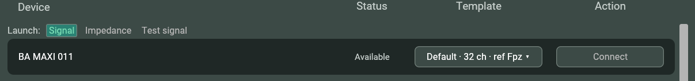
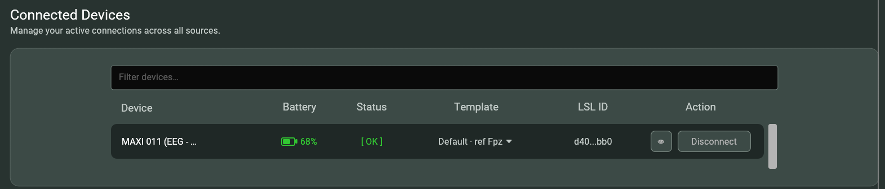

# Instrukcja obsługi urządzeń EEG BrainAccess (English below)

## Instalacja

### Pobieranie
1. Pobierz najnowszą wersję [BrainAccess Board](https://www.brainaccess.ai/download/)
2. Podążaj za instrukcjami wyświetlanymi na ekranie

## Łączenie z urządzeniem

1. Włącz urządzenie, przytrzymując przycisk aż dioda zaświeci się na niebiesko (w opasce HALO wystąpią dodatkowo drgania)
2. Włącz Bluetooth na komputerze lub użyj dołączonego do zestawu adaptera Bluetooth (**NIE ŁĄCZ SIĘ Z URZĄDZENIEM** samodzielnie przez ustawienia systemowe)
3. Uruchom zainstalowany program BrainAccess Board
4. Znajdź na liście urządzenie, z którym chcesz nawiązać połączenie, i kliknij **Connect**
   
   
  
5. Przy udanym połączeniu urządzenie powinno pojawić się w sekcji **Connected Devices** ze statusem `[ OK ]`
   
   

6. Możemy wyświetlić surowy sygnał EEG oraz zobaczyć stan poszczególnych kanałów, klikając ikonkę oka obok przycisku **Disconnect**.

   Możliwe są 3 stany: zielony, żółty i czerwony. Jeżeli przez większość czasu większość kanałów jest zielona lub żółta wszystko jest ok. Natomiast w przypadku dominujących stanów czerwonych i żółtych należy zweryfikować poprawność założenia czepka.
   
   

## Rozwiązywanie problemów

### Nie widzę mojego urządzenia na liście
- Sprawdź, czy urządzenie jest włączone i nie jest rozładowane
- Sprawdź, czy Bluetooth jest włączony lub czy używasz adaptera
- Spróbuj zamknąć program BrainAccess Board, następnie najpierw włącz opaskę i Bluetooth, odczekaj 10 sekund i uruchom aplikację ponownie

### Sygnał jest bardzo słaby
- Upewnij się, że elektrody dobrze przylegają do głowy
- W przypadku opaski HALO sprawdź, czy włosy nie znajdują się pod płaskimi elektrodami czołowymi

### Potrzebujesz dodatkowej pomocy?
W przypadku jakichkolwiek problemów z urządzeniami EEG możesz poprosić o pomoc naszego technika!

   

# BrainAccess EEG Devices Instruction Manual

## Installation

### Downloading
1. Download the latest version of [BrainAccess Board](https://www.brainaccess.ai/download/)
2. Follow the on-screen instructions

## Connecting the Device

1. Turn on the device by holding the button until the LED lights up blue (the HALO headband will additionally vibrate)
2. Enable Bluetooth on your computer or use the Bluetooth adapter included in the kit (**DO NOT PAIR/CONNECT THE DEVICE** yourself via system settings)
3. Launch the installed BrainAccess Board program
4. Find the device you want to connect to on the list and click **Connect**
   
  
  
5. If the connection is successful, the device should appear under **Connected Devices** with status `[ OK ]`
   
  

6. We can display the raw EEG signal and see the status of individual channels by clicking the eye icon next to the **Disconnect** button.

  There are 3 possible states: green, yellow, and red. If the majority of channels are green or yellow most of the time, everything is fine. However, in the case of dominant red and yellow states, the correctness of the headset placement should be verified.

  

## Troubleshooting

### I can't see my device on the list
- Check if your device is turned on and not out of battery
- Check if Bluetooth is enabled or if you are using the adapter
- Try closing the BrainAccess Board program, then first turn on the headband and Bluetooth, wait for 10 seconds, and launch the application again

### The signal is very weak
- Make sure the electrodes have good contact with the head
- In the case of the HALO headband, check that no hair is under the flat forehead electrodes

### Need additional help?
Feel free to ask our technical staff for any help with EEG devices!
